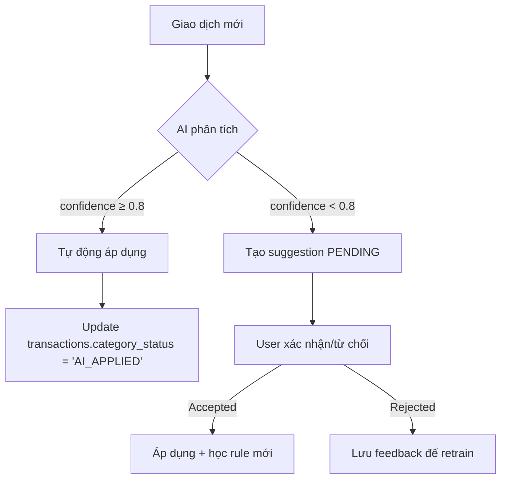
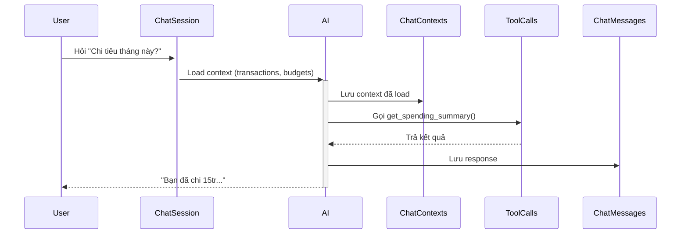
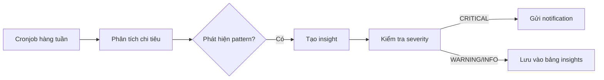

# Đặc Tả Chi Tiết Schema AI

**Hệ thống:** Quản Lý Tài Chính Cá Nhân với Trợ Lý AI  
**Phiên bản:** 2.1  
**Cập nhật:** 11/10/2026

---

## 📋 Mục Lục

1. [Tổng Quan](#tổng-quan)
2. [Nhóm Phân Loại & Gợi Ý](#nhóm-phân-loại--gợi-ý)
3. [Nhóm Trợ Lý Chat](#nhóm-trợ-lý-chat)
4. [Nhóm Insight & Dự Báo](#nhóm-insight--dự-báo)
5. [Nhóm Phát Hiện Bất Thường](#nhóm-phát-hiện-bất-thường)
6. [Nhóm Feedback & Training](#nhóm-feedback--training)
7. [Bảng Tổng Hợp](#bảng-tổng-hợp)

---

## Tổng Quan

Schema `ai` chứa 17 bảng phục vụ các tính năng AI/ML:

- **Phân loại tự động:** Gán category, merchant, tags cho giao dịch
- **Trợ lý chat:** Lịch sử hội thoại, context, tool calls
- **Insights:** Phân tích xu hướng, so sánh với người dùng khác
- **Dự báo:** Dự đoán chi tiêu, số dư tài khoản
- **Phát hiện bất thường:** Giao dịch lạ, rủi ro
- **Feedback loop:** Học từ phản hồi người dùng

**Lưu ý:** Bảng `ai_ocr_jobs` đã được **hợp nhất vào `core.receipts`** để giảm phức tạp.

---

## Nhóm Phân Loại & Gợi Ý

### ai.classification_models (Model Phân Loại)

**Mô tả:** Metadata các model ML đã train

| Cột | Kiểu | Ràng buộc | Mô tả |
|-----|------|-----------|-------|
| id | UUID | PK | |
| model_name | VARCHAR(100) | NOT NULL | Tên model (category_classifier_v2) |
| version | VARCHAR(50) | NOT NULL | Phiên bản (2.3.1) |
| model_type | VARCHAR(50) | NOT NULL | CATEGORY, MERCHANT, TAG, ANOMALY |
| storage_path | TEXT | NOT NULL | S3/local path |
| metrics | JSONB | NULL | accuracy, f1_score, precision, recall |
| is_active | BOOLEAN | NOT NULL, DEFAULT false | Model đang dùng |
| trained_at | TIMESTAMPTZ | NULL | |
| created_at | TIMESTAMPTZ | NOT NULL, DEFAULT now() | |
| created_by | UUID | NULL, FK → core.users | |

**Index:**
- `idx_ai_models_active` (model_type, is_active) WHERE is_active = true
- UNIQUE (model_name, version)

---

### ai.category_suggestions (Gợi Ý Danh Mục)

**Mô tả:** AI đề xuất category cho giao dịch

| Cột | Kiểu | Ràng buộc | Mô tả |
|-----|------|-----------|-------|
| id | UUID | PK | |
| transaction_id | UUID | NOT NULL, FK CASCADE → core.transactions | |
| suggested_category_id | UUID | NOT NULL, FK → core.categories | |
| confidence_score | DECIMAL(5,4) | NOT NULL, CHECK 0-1 | 0.0000 → 1.0000 |
| model_version | VARCHAR(50) | NOT NULL | Version model đã dùng |
| reasoning | TEXT | NULL | Giải thích (tùy chọn) |
| status | suggestion_status | NOT NULL, DEFAULT 'PENDING' | PENDING, ACCEPTED, REJECTED, IGNORED |
| user_action_at | TIMESTAMPTZ | NULL | Thời điểm user phản hồi |
| created_at | TIMESTAMPTZ | NOT NULL, DEFAULT now() | |

**Index:**
- `idx_ai_cat_suggestions_tx` (transaction_id)
- `idx_ai_cat_suggestions_status` (status, created_at)

**Luồng:**
1. Giao dịch mới → AI tạo suggestion với confidence
2. confidence ≥ 0.8 → tự động áp dụng (status=ACCEPTED, core.transactions.category_status='AI_APPLIED')
3. confidence < 0.8 → PENDING, user xác nhận

---

### ai.merchant_suggestions (Gợi Ý Cửa Hàng)

**Mô tả:** AI đề xuất merchant

| Cột | Kiểu | Ràng buộc | Mô tả |
|-----|------|-----------|-------|
| id | UUID | PK | |
| transaction_id | UUID | NOT NULL, FK CASCADE → core.transactions | |
| suggested_merchant_id | UUID | NOT NULL, FK → core.merchants | |
| confidence_score | DECIMAL(5,4) | NOT NULL, CHECK 0-1 | |
| extracted_name | VARCHAR(255) | NULL | Tên trích xuất từ description |
| status | suggestion_status | NOT NULL, DEFAULT 'PENDING' | |
| user_action_at | TIMESTAMPTZ | NULL | |
| created_at | TIMESTAMPTZ | NOT NULL, DEFAULT now() | |

**Index:** (transaction_id), (status, created_at)

---

### ai.tag_suggestions (Gợi Ý Nhãn)

**Mô tả:** AI đề xuất tags (có thể nhiều tag/transaction)

| Cột | Kiểu | Ràng buộc | Mô tả |
|-----|------|-----------|-------|
| id | UUID | PK | |
| transaction_id | UUID | NOT NULL, FK CASCADE → core.transactions | |
| suggested_tag_id | UUID | NOT NULL, FK → core.tags | |
| confidence_score | DECIMAL(5,4) | NOT NULL | |
| reasoning | TEXT | NULL | |
| status | suggestion_status | NOT NULL, DEFAULT 'PENDING' | |
| user_action_at | TIMESTAMPTZ | NULL | |
| created_at | TIMESTAMPTZ | NOT NULL, DEFAULT now() | |

**Index:** (transaction_id), (suggested_tag_id)

---

### ai.smart_rules (Quy Tắc Thông Minh)

**Mô tả:** Quy tắc do AI học hoặc user tạo

| Cột | Kiểu | Ràng buộc | Mô tả |
|-----|------|-----------|-------|
| id | UUID | PK | |
| user_id | UUID | NOT NULL, FK → core.users | |
| rule_name | VARCHAR(255) | NOT NULL | |
| priority | INTEGER | NOT NULL, DEFAULT 0 | Thứ tự áp dụng (cao → thấp) |
| conditions | JSONB | NOT NULL | {"description": {"contains": "Grab"}} |
| actions | JSONB | NOT NULL | {"category_id": "...", "merchant_id": "..."} |
| is_active | BOOLEAN | NOT NULL, DEFAULT true | |
| apply_to_future | BOOLEAN | NOT NULL, DEFAULT true | Áp dụng cho giao dịch mới |
| apply_to_past | BOOLEAN | NOT NULL, DEFAULT false | Áp dụng cho giao dịch cũ |
| auto_created_by_ai | BOOLEAN | NOT NULL, DEFAULT false | AI tự tạo |
| times_applied | INTEGER | NOT NULL, DEFAULT 0 | Số lần đã áp dụng |
| last_applied_at | TIMESTAMPTZ | NULL | |
| **created_at** | TIMESTAMPTZ | NOT NULL | |
| **updated_at** | TIMESTAMPTZ | NOT NULL | |

**Index:** (user_id, is_active, priority)

**Ví dụ:**
```json
{
  "conditions": {
    "description": {"contains_any": ["Grab", "GrabFood"]},
    "amount": {"gte": 50000, "lte": 500000}
  },
  "actions": {
    "category_id": "uuid-food-delivery",
    "merchant_id": "uuid-grab",
    "tags": ["delivery", "lunch"]
  }
}
```

---

## Nhóm Trợ Lý Chat

### ai.chat_sessions (Phiên Chat)

**Mô tả:** Phiên hội thoại với AI assistant

| Cột | Kiểu | Ràng buộc | Mô tả |
|-----|------|-----------|-------|
| id | UUID | PK | |
| user_id | UUID | NOT NULL, FK → core.users | |
| title | VARCHAR(255) | NULL | Tự động tạo từ tin nhắn đầu |
| summary | TEXT | NULL | AI tóm tắt nội dung |
| status | chat_status | NOT NULL, DEFAULT 'ACTIVE' | ACTIVE, ARCHIVED, DELETED |
| message_count | INTEGER | NOT NULL, DEFAULT 0 | Số tin nhắn |
| last_message_at | TIMESTAMPTZ | NULL | |
| metadata | JSONB | NULL | Lưu context, preferences |
| **created_at** | TIMESTAMPTZ | NOT NULL | |
| **updated_at** | TIMESTAMPTZ | NOT NULL | |

**Index:** (user_id, status, last_message_at)

---

### ai.chat_messages (Tin Nhắn Chat)

**Mô tả:** Lịch sử tin nhắn trong phiên chat

| Cột | Kiểu | Ràng buộc | Mô tả |
|-----|------|-----------|-------|
| id | UUID | PK | |
| session_id | UUID | NOT NULL, FK CASCADE → chat_sessions | |
| role | chat_role | NOT NULL | USER, ASSISTANT, SYSTEM |
| content | TEXT | NOT NULL | Nội dung tin nhắn |
| token_count | INTEGER | NULL | Số token (cho billing) |
| metadata | JSONB | NULL | model, temperature, tools_used |
| parent_message_id | UUID | NULL, FK → chat_messages | Cấu trúc cây (nếu có branching) |
| created_at | TIMESTAMPTZ | NOT NULL, DEFAULT now() | |

**Index:**
- `idx_chat_messages_session` (session_id, created_at)
- `idx_chat_messages_parent` (parent_message_id)

---

### ai.chat_contexts (Context Chat)

**Mô tả:** Context được load vào chat (accounts, goals, transactions...)

| Cột | Kiểu | Ràng buộc | Mô tả |
|-----|------|-----------|-------|
| id | UUID | PK | |
| session_id | UUID | NOT NULL, FK CASCADE → chat_sessions | |
| entity_type | VARCHAR(50) | NOT NULL | accounts, transactions, goals, budgets |
| entity_id | UUID | NOT NULL | |
| context_data | JSONB | NOT NULL | Snapshot dữ liệu |
| loaded_at | TIMESTAMPTZ | NOT NULL, DEFAULT now() | |

**Index:** (session_id, entity_type)

**Ví dụ:** User hỏi "Chi tiêu tháng này thế nào?" → AI load transactions của tháng hiện tại vào context

---

### ai.tool_calls (Lịch Sử Gọi Tool)

**Mô tả:** AI assistant gọi tool/function

| Cột | Kiểu | Ràng buộc | Mô tả |
|-----|------|-----------|-------|
| id | UUID | PK | |
| message_id | UUID | NOT NULL, FK CASCADE → chat_messages | |
| tool_name | VARCHAR(100) | NOT NULL | get_transactions, create_budget, analyze_spending |
| parameters | JSONB | NULL | Tham số đầu vào |
| result | JSONB | NULL | Kết quả trả về |
| execution_time_ms | INTEGER | NULL | Thời gian thực thi |
| status | tool_call_status | NOT NULL | SUCCESS, FAILED, TIMEOUT |
| error_message | TEXT | NULL | |
| called_at | TIMESTAMPTZ | NOT NULL, DEFAULT now() | |

**Index:** (message_id), (tool_name, status)

---

## Nhóm Insight & Dự Báo

### ai.insights (Insight Tài Chính)

**Mô tả:** Thông tin phân tích định kỳ từ AI

| Cột | Kiểu | Ràng buộc | Mô tả |
|-----|------|-----------|-------|
| id | UUID | PK | |
| user_id | UUID | NOT NULL, FK → core.users | |
| insight_type | insight_type | NOT NULL | SPENDING_PATTERN, SAVING_OPPORTUNITY, BUDGET_RISK, GOAL_PROGRESS, PEER_COMPARISON, FORECAST |
| severity | insight_severity | NOT NULL | INFO, WARNING, CRITICAL |
| title | VARCHAR(255) | NOT NULL | "Chi tiêu ăn uống tăng 35%" |
| description | TEXT | NOT NULL | Mô tả chi tiết |
| actionable | BOOLEAN | NOT NULL, DEFAULT false | Có hành động khuyến nghị không |
| action_text | VARCHAR(255) | NULL | "Đặt ngân sách ăn uống 5tr/tháng" |
| action_payload | JSONB | NULL | {"type": "create_budget", "params": {...}} |
| related_entities | JSONB | NULL | [{"type": "category", "id": "..."}, ...] |
| insight_date | DATE | NOT NULL | Ngày insight |
| is_read | BOOLEAN | NOT NULL, DEFAULT false | |
| is_dismissed | BOOLEAN | NOT NULL, DEFAULT false | |
| created_at | TIMESTAMPTZ | NOT NULL, DEFAULT now() | |

**Index:**
- `idx_ai_insights_user_date` (user_id, insight_date DESC)
- `idx_ai_insights_unread` (user_id, is_read, is_dismissed) WHERE NOT is_read AND NOT is_dismissed

---

### ai.spending_forecasts (Dự Báo Chi Tiêu)

**Mô tả:** Dự đoán chi tiêu theo category/tháng

| Cột | Kiểu | Ràng buộc | Mô tả |
|-----|------|-----------|-------|
| id | UUID | PK | |
| user_id | UUID | NOT NULL, FK → core.users | |
| category_id | UUID | NULL, FK → core.categories | NULL = tổng |
| forecast_month | DATE | NOT NULL | Tháng dự báo (ngày đầu tháng) |
| predicted_amount | DECIMAL(15,2) | NOT NULL | Số tiền dự đoán |
| currency_code | CHAR(3) | NOT NULL, FK → core.currencies | |
| confidence_interval_lower | DECIMAL(15,2) | NULL | Khoảng tin cậy dưới |
| confidence_interval_upper | DECIMAL(15,2) | NULL | Khoảng tin cậy trên |
| actual_amount | DECIMAL(15,2) | NULL | Số thực tế (sau khi tháng kết thúc) |
| model_version | VARCHAR(50) | NOT NULL | |
| created_at | TIMESTAMPTZ | NOT NULL, DEFAULT now() | |

**Index:** (user_id, forecast_month, category_id)

**Cập nhật:** Cronjob cuối tháng tính actual_amount

---

### ai.balance_forecasts (Dự Báo Số Dư)

**Mô tả:** Dự đoán số dư tài khoản theo ngày

| Cột | Kiểu | Ràng buộc | Mô tả |
|-----|------|-----------|-------|
| id | UUID | PK | |
| account_id | UUID | NOT NULL, FK → core.accounts | |
| forecast_date | DATE | NOT NULL | Ngày dự báo |
| predicted_balance | DECIMAL(15,2) | NOT NULL | |
| confidence_score | DECIMAL(5,4) | NULL | |
| factors | JSONB | NULL | {"recurring_bills": [...], "expected_income": ...} |
| actual_balance | DECIMAL(15,2) | NULL | Số dư thực tế |
| created_at | TIMESTAMPTZ | NOT NULL, DEFAULT now() | |

**Index:** (account_id, forecast_date)

---

### ai.spending_patterns (Mô Hình Chi Tiêu)

**Mô tả:** Phân tích pattern từ lịch sử

| Cột | Kiểu | Ràng buộc | Mô tả |
|-----|------|-----------|-------|
| id | UUID | PK | |
| user_id | UUID | NOT NULL, FK → core.users | |
| pattern_type | pattern_type | NOT NULL | WEEKLY, MONTHLY, SEASONAL, EVENT_BASED |
| category_id | UUID | NULL, FK → core.categories | |
| merchant_id | UUID | NULL, FK → core.merchants | |
| description | TEXT | NOT NULL | "Mua café mỗi sáng thứ 2-6" |
| frequency | VARCHAR(50) | NULL | "5 times per week" |
| avg_amount | DECIMAL(15,2) | NULL | Số tiền trung bình |
| currency_code | CHAR(3) | NULL, FK → core.currencies | |
| confidence_score | DECIMAL(5,4) | NOT NULL | |
| first_observed | DATE | NOT NULL | |
| last_observed | DATE | NOT NULL | |
| is_active | BOOLEAN | NOT NULL, DEFAULT true | |
| created_at | TIMESTAMPTZ | NOT NULL, DEFAULT now() | |
| updated_at | TIMESTAMPTZ | NOT NULL, DEFAULT now() | |

**Index:** (user_id, is_active)

---

## Nhóm Phát Hiện Bất Thường

### ai.anomaly_detections (Phát Hiện Bất Thường)

**Mô tả:** Giao dịch/hành vi bất thường

| Cột | Kiểu | Ràng buộc | Mô tả |
|-----|------|-----------|-------|
| id | UUID | PK | |
| user_id | UUID | NOT NULL, FK → core.users | |
| transaction_id | UUID | NULL, FK → core.transactions | Giao dịch gây cảnh báo |
| anomaly_type | anomaly_type | NOT NULL | UNUSUAL_AMOUNT, UNUSUAL_MERCHANT, UNUSUAL_TIME, DUPLICATE, FRAUD_RISK |
| severity | anomaly_severity | NOT NULL | LOW, MEDIUM, HIGH, CRITICAL |
| description | TEXT | NOT NULL | |
| anomaly_score | DECIMAL(5,4) | NOT NULL, CHECK 0-1 | 0 = bình thường, 1 = rất lạ |
| model_version | VARCHAR(50) | NOT NULL | |
| is_reviewed | BOOLEAN | NOT NULL, DEFAULT false | User đã xem chưa |
| is_false_positive | BOOLEAN | NULL | User đánh dấu nhầm |
| reviewed_at | TIMESTAMPTZ | NULL | |
| detected_at | TIMESTAMPTZ | NOT NULL, DEFAULT now() | |

**Index:**
- `idx_ai_anomalies_user` (user_id, detected_at DESC)
- `idx_ai_anomalies_unreviewed` (is_reviewed, severity) WHERE NOT is_reviewed

---

## Nhóm Feedback & Training

### ai.user_feedback (Phản Hồi Người Dùng)

**Mô tả:** Feedback cho predictions/suggestions của AI

| Cột | Kiểu | Ràng buộc | Mô tả |
|-----|------|-----------|-------|
| id | UUID | PK | |
| user_id | UUID | NOT NULL, FK → core.users | |
| feedback_type | feedback_type | NOT NULL | CATEGORY_CORRECTION, MERCHANT_CORRECTION, INSIGHT_RATING, CHAT_RATING, ANOMALY_FEEDBACK |
| related_entity_type | VARCHAR(50) | NOT NULL | category_suggestions, insights, chat_messages |
| related_entity_id | UUID | NOT NULL | |
| rating | SMALLINT | NULL, CHECK 1-5 | 1-5 sao |
| is_helpful | BOOLEAN | NULL | Có hữu ích không |
| correction_data | JSONB | NULL | {"expected_category_id": "...", "reason": "..."} |
| comment | TEXT | NULL | |
| created_at | TIMESTAMPTZ | NOT NULL, DEFAULT now() | |

**Index:** (related_entity_type, related_entity_id)

**Mục đích:** Training data cho model tiếp theo

---

### ai.model_training_jobs (Job Training Model)

**Mô tả:** Theo dõi quá trình train model

| Cột | Kiểu | Ràng buộc | Mô tả |
|-----|------|-----------|-------|
| id | UUID | PK | |
| job_name | VARCHAR(255) | NOT NULL | |
| model_type | VARCHAR(50) | NOT NULL | CATEGORY, MERCHANT, ANOMALY, FORECAST |
| status | job_status | NOT NULL, DEFAULT 'PENDING' | PENDING, RUNNING, COMPLETED, FAILED |
| training_data_count | INTEGER | NULL | Số lượng mẫu |
| validation_metrics | JSONB | NULL | {"accuracy": 0.92, "f1": 0.89} |
| output_model_id | UUID | NULL, FK → classification_models | Model đã train |
| started_at | TIMESTAMPTZ | NULL | |
| completed_at | TIMESTAMPTZ | NULL | |
| error_message | TEXT | NULL | |
| created_at | TIMESTAMPTZ | NOT NULL, DEFAULT now() | |
| created_by | UUID | NULL, FK → core.users | |

**Index:** (status, started_at)

---

## Bảng Tổng Hợp

### Thống Kê AI Schema

| Nhóm | Số bảng | Mô tả |
|------|---------|-------|
| Phân loại & Gợi ý | 5 | classification_models, category_suggestions, merchant_suggestions, tag_suggestions, smart_rules |
| Trợ lý Chat | 4 | chat_sessions, chat_messages, chat_contexts, tool_calls |
| Insight & Dự báo | 4 | insights, spending_forecasts, balance_forecasts, spending_patterns |
| Phát hiện bất thường | 1 | anomaly_detections |
| Feedback & Training | 2 | user_feedback, model_training_jobs |
| **Tổng cộng** | **17** | (không tính ai_ocr_jobs đã hợp nhất) |

---

## Luồng Hoạt Động Chính

### 1. Phân Loại Giao Dịch Tự Động



### 2. Chat với Trợ Lý AI



### 3. Tạo Insight Hàng Tuần



---

## Enum Types Sử Dụng

```sql
-- Định nghĩa trong 02-tong-quan-co-so-du-lieu.md
CREATE TYPE suggestion_status AS ENUM ('PENDING', 'ACCEPTED', 'REJECTED', 'IGNORED');
CREATE TYPE chat_status AS ENUM ('ACTIVE', 'ARCHIVED', 'DELETED');
CREATE TYPE chat_role AS ENUM ('USER', 'ASSISTANT', 'SYSTEM');
CREATE TYPE tool_call_status AS ENUM ('SUCCESS', 'FAILED', 'TIMEOUT');
CREATE TYPE insight_type AS ENUM ('SPENDING_PATTERN', 'SAVING_OPPORTUNITY', 'BUDGET_RISK', 'GOAL_PROGRESS', 'PEER_COMPARISON', 'FORECAST');
CREATE TYPE insight_severity AS ENUM ('INFO', 'WARNING', 'CRITICAL');
CREATE TYPE pattern_type AS ENUM ('WEEKLY', 'MONTHLY', 'SEASONAL', 'EVENT_BASED');
CREATE TYPE anomaly_type AS ENUM ('UNUSUAL_AMOUNT', 'UNUSUAL_MERCHANT', 'UNUSUAL_TIME', 'DUPLICATE', 'FRAUD_RISK');
CREATE TYPE anomaly_severity AS ENUM ('LOW', 'MEDIUM', 'HIGH', 'CRITICAL');
CREATE TYPE feedback_type AS ENUM ('CATEGORY_CORRECTION', 'MERCHANT_CORRECTION', 'INSIGHT_RATING', 'CHAT_RATING', 'ANOMALY_FEEDBACK');
CREATE TYPE job_status AS ENUM ('PENDING', 'RUNNING', 'COMPLETED', 'FAILED');
```

---

## Liên Kết

- ← [04. Schema Core Chi Tiết](04-schema-core-chi-tiet.md)
- → [07. Schema OPS Chi Tiết](07-schema-ops-chi-tiet.md)
- → [02. Tổng Quan Cơ Sở Dữ Liệu](02-tong-quan-co-so-du-lieu.md)
- → [03. Quy Tắc Nghiệp Vụ](03-quy-tac-nghiep-vu.md)
