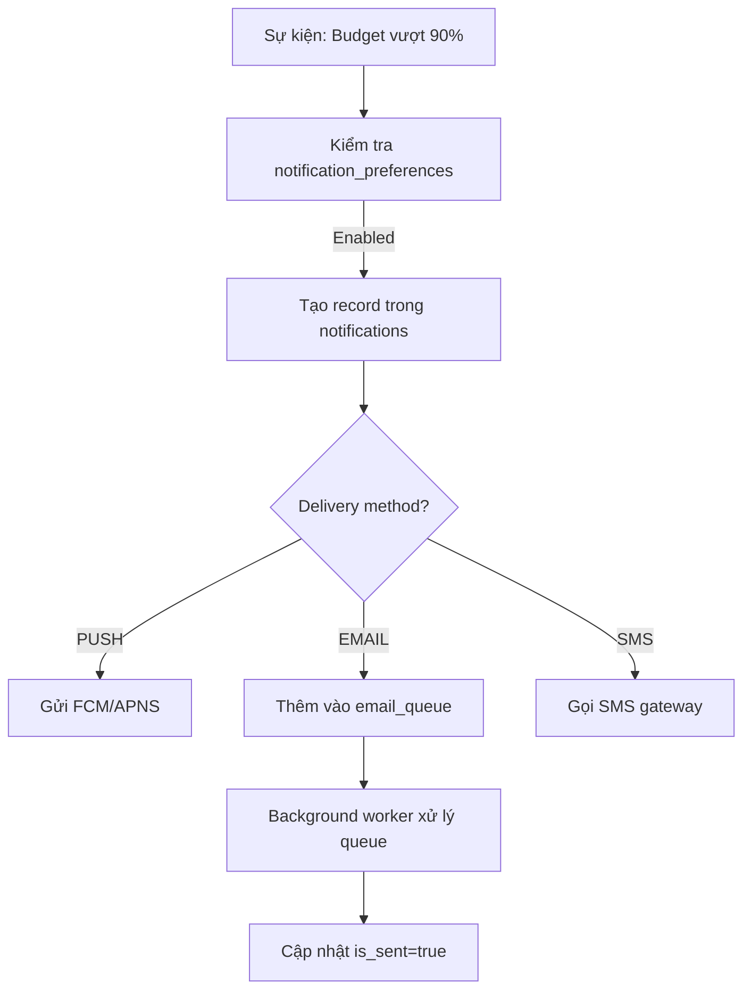
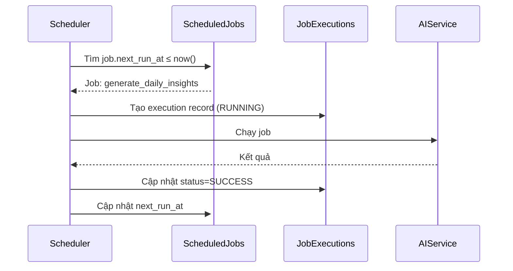
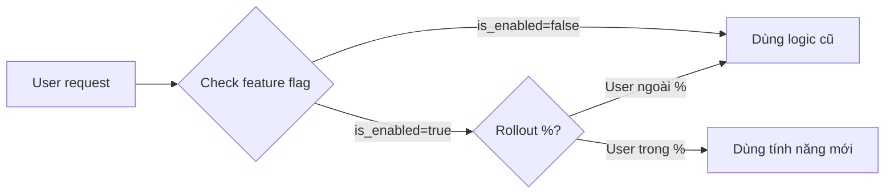

# Đặc Tả Chi Tiết Schema OPS

**Hệ thống:** Quản Lý Tài Chính Cá Nhân với Trợ Lý AI  
**Phiên bản:** 2.1  
**Cập nhật:** 11/10/2026

---

## 📋 Mục Lục

1. [Tổng Quan](#tổng-quan)
2. [Nhóm Audit & Logging](#nhóm-audit--logging)
3. [Nhóm Notifi & Email](#nhóm-notification--email)
4. [Nhóm Job Scheduling](#nhóm-job-scheduling)
5. [Nhóm Feature Flags](#nhóm-feature-flags)
6. [Nhóm API Rate Limiting](#nhóm-api-rate-limiting)
7. [Bảng Tổng Hợp](#bảng-tổng-hợp)

---

## Tổng Quan

Schema `ops` chứa 8 bảng phục vụ vận hành hệ thống:

- **Audit logs:** Theo dõi hành động quan trọng
- **Notification:** Gửi thông báo push/email/SMS
- **Email queue:** Hàng đợi gửi email
- **Job scheduling:** Cron jobs, async tasks
- **Feature flags:** Bật/tắt tính năng động
- **Rate limiting:** Giới hạn API calls

**Mục đích:** Tách biệt các tính năng vận hành khỏi business logic chính.

---

## Nhóm Audit & Logging

### ops.audit_logs (Nhật Ký Kiểm Toán)

**Mô tả:** Ghi lại mọi hành động quan trọng của user và hệ thống

| Cột | Kiểu | Ràng buộc | Mô tả |
|-----|------|-----------|-------|
| id | UUID | PK | |
| user_id | UUID | NULL, FK → core.users | NULL = system action |
| action_type | audit_action_type | NOT NULL | LOGIN, LOGOUT, CREATE, UPDATE, DELETE, EXPORT, SHARE, ADMIN_ACTION |
| entity_type | VARCHAR(50) | NULL | transactions, accounts, goals... |
| entity_id | UUID | NULL | ID của entity |
| changes | JSONB | NULL | {"before": {...}, "after": {...}} |
| ip_address | INET | NULL | Địa chỉ IP |
| user_agent | TEXT | NULL | Browser/app info |
| status | audit_status | NOT NULL | SUCCESS, FAILED, BLOCKED |
| error_message | TEXT | NULL | Nếu FAILED |
| metadata | JSONB | NULL | Context bổ sung |
| created_at | TIMESTAMPTZ | NOT NULL, DEFAULT now() | |

**Partitioning:** RANGE(created_at) theo tháng (vì dữ liệu lớn)

**Index:**
- `idx_audit_user_action` (user_id, action_type, created_at DESC)
- `idx_audit_entity` (entity_type, entity_id)
- `idx_audit_created_at` (created_at DESC)

**Retention:** Lưu 2 năm, sau đó archive sang cold storage

**Ví dụ:**
```json
{
  "action_type": "UPDATE",
  "entity_type": "transactions",
  "entity_id": "uuid-123",
  "changes": {
    "before": {"amount": 100000, "category_id": "old-uuid"},
    "after": {"amount": 150000, "category_id": "new-uuid"}
  }
}
```

---

### ops.error_logs (Nhật Ký Lỗi)

**Mô tả:** Ghi exception, lỗi hệ thống

| Cột | Kiểu | Ràng buộc | Mô tả |
|-----|------|-----------|-------|
| id | UUID | PK | |
| user_id | UUID | NULL, FK → core.users | |
| error_type | VARCHAR(100) | NOT NULL | DatabaseError, ValidationError, AIServiceError |
| error_code | VARCHAR(50) | NULL | E_INSUFFICIENT_BALANCE |
| message | TEXT | NOT NULL | |
| stack_trace | TEXT | NULL | |
| request_path | VARCHAR(500) | NULL | API endpoint |
| request_method | VARCHAR(10) | NULL | GET, POST, PUT, DELETE |
| request_body | JSONB | NULL | Request payload (cẩn thận PII) |
| severity | error_severity | NOT NULL | DEBUG, INFO, WARNING, ERROR, CRITICAL |
| is_resolved | BOOLEAN | NOT NULL, DEFAULT false | |
| resolved_at | TIMESTAMPTZ | NULL | |
| resolved_by | UUID | NULL, FK → core.users | Admin đã xử lý |
| created_at | TIMESTAMPTZ | NOT NULL, DEFAULT now() | |

**Index:**
- `idx_error_severity_unresolved` (severity, is_resolved, created_at DESC) WHERE NOT is_resolved
- `idx_error_user` (user_id, created_at DESC)

**Alert:** severity=CRITICAL → gửi Slack/PagerDuty

---

## Nhóm Notification & Email

### ops.notifications (Thông Báo)

**Mô tả:** Thông báo push/in-app cho user

| Cột | Kiểu | Ràng buộc | Mô tả |
|-----|------|-----------|-------|
| id | UUID | PK | |
| user_id | UUID | NOT NULL, FK CASCADE → core.users | |
| notification_type | notification_type | NOT NULL | TRANSACTION, BUDGET_ALERT, GOAL_ACHIEVED, SYSTEM, MARKETING |
| title | VARCHAR(255) | NOT NULL | |
| body | TEXT | NOT NULL | |
| action_url | VARCHAR(500) | NULL | Deep link vào app |
| related_entity_type | VARCHAR(50) | NULL | transactions, budgets, goals |
| related_entity_id | UUID | NULL | |
| priority | notification_priority | NOT NULL, DEFAULT 'NORMAL' | LOW, NORMAL, HIGH, URGENT |
| delivery_method | notification_method | NOT NULL, DEFAULT 'PUSH' | PUSH, EMAIL, SMS, IN_APP |
| is_sent | BOOLEAN | NOT NULL, DEFAULT false | |
| sent_at | TIMESTAMPTZ | NULL | |
| is_read | BOOLEAN | NOT NULL, DEFAULT false | |
| read_at | TIMESTAMPTZ | NULL | |
| expires_at | TIMESTAMPTZ | NULL | Thông báo có thời hạn |
| created_at | TIMESTAMPTZ | NOT NULL, DEFAULT now() | |

**Index:**
- `idx_notif_user_unread` (user_id, is_read, created_at DESC) WHERE NOT is_read
- `idx_notif_unsent` (is_sent, priority, created_at) WHERE NOT is_sent

**Cleanup:** Xóa thông báo đã đọc > 90 ngày

---

### ops.email_queue (Hàng Đợi Email)

**Mô tả:** Queue gửi email (transactional + marketing)

| Cột | Kiểu | Ràng buộc | Mô tả |
|-----|------|-----------|-------|
| id | UUID | PK | |
| user_id | UUID | NULL, FK → core.users | |
| to_email | VARCHAR(320) | NOT NULL | Email người nhận |
| cc | TEXT[] | NULL | Danh sách CC |
| bcc | TEXT[] | NULL | Danh sách BCC |
| subject | VARCHAR(255) | NOT NULL | |
| body_html | TEXT | NULL | HTML template |
| body_text | TEXT | NULL | Plain text fallback |
| template_name | VARCHAR(100) | NULL | welcome_email, password_reset |
| template_data | JSONB | NULL | Biến để render template |
| priority | email_priority | NOT NULL, DEFAULT 'NORMAL' | LOW, NORMAL, HIGH |
| status | email_status | NOT NULL, DEFAULT 'PENDING' | PENDING, SENDING, SENT, FAILED, BOUNCED |
| provider | VARCHAR(50) | NULL | SendGrid, AWS SES |
| provider_message_id | VARCHAR(255) | NULL | ID từ email provider |
| send_at | TIMESTAMPTZ | NULL | Lên lịch gửi |
| sent_at | TIMESTAMPTZ | NULL | |
| failed_at | TIMESTAMPTZ | NULL | |
| error_message | TEXT | NULL | |
| retry_count | SMALLINT | NOT NULL, DEFAULT 0 | Số lần retry |
| max_retries | SMALLINT | NOT NULL, DEFAULT 3 | |
| created_at | TIMESTAMPTZ | NOT NULL, DEFAULT now() | |

**Index:**
- `idx_email_queue_pending` (status, priority, send_at) WHERE status = 'PENDING'
- `idx_email_queue_user` (user_id, created_at DESC)

**Worker:** Background job xử lý queue 1 phút/lần

---

### ops.notification_preferences (Tùy Chọn Thông Báo)

**Mô tả:** User cấu hình nhận thông báo gì

| Cột | Kiểu | Ràng buộc | Mô tả |
|-----|------|-----------|-------|
| user_id | UUID | PK, FK CASCADE → core.users | |
| push_enabled | BOOLEAN | NOT NULL, DEFAULT true | |
| email_enabled | BOOLEAN | NOT NULL, DEFAULT true | |
| sms_enabled | BOOLEAN | NOT NULL, DEFAULT false | |
| transaction_alerts | BOOLEAN | NOT NULL, DEFAULT true | Giao dịch mới |
| budget_alerts | BOOLEAN | NOT NULL, DEFAULT true | Vượt ngân sách |
| goal_reminders | BOOLEAN | NOT NULL, DEFAULT true | Tiến độ mục tiêu |
| ai_insights | BOOLEAN | NOT NULL, DEFAULT true | Insight từ AI |
| marketing_emails | BOOLEAN | NOT NULL, DEFAULT false | Email quảng cáo |
| weekly_summary | BOOLEAN | NOT NULL, DEFAULT true | Báo cáo tuần |
| quiet_hours_start | TIME | NULL | 22:00 |
| quiet_hours_end | TIME | NULL | 07:00 |
| timezone | VARCHAR(50) | NOT NULL, DEFAULT 'UTC' | Asia/Ho_Chi_Minh |
| created_at | TIMESTAMPTZ | NOT NULL, DEFAULT now() | |
| updated_at | TIMESTAMPTZ | NOT NULL, DEFAULT now() | |

**Default:** Tạo tự động khi user đăng ký

---

## Nhóm Job Scheduling

### ops.scheduled_jobs (Job Định Kỳ)

**Mô tả:** Cron jobs và recurring tasks

| Cột | Kiểu | Ràng buộc | Mô tả |
|-----|------|-----------|-------|
| id | UUID | PK | |
| job_name | VARCHAR(100) | NOT NULL, UNIQUE | generate_daily_insights |
| job_type | job_type | NOT NULL | CRON, ONE_TIME, RECURRING |
| cron_expression | VARCHAR(100) | NULL | '0 2 * * *' (2am hàng ngày) |
| handler_class | VARCHAR(255) | NOT NULL | Java class hoặc Python function |
| parameters | JSONB | NULL | Config cho job |
| status | job_status | NOT NULL, DEFAULT 'ACTIVE' | ACTIVE, PAUSED, DISABLED |
| last_run_at | TIMESTAMPTZ | NULL | |
| next_run_at | TIMESTAMPTZ | NULL | |
| last_run_status | job_run_status | NULL | SUCCESS, FAILED, TIMEOUT |
| last_run_duration_ms | INTEGER | NULL | |
| failure_count | INTEGER | NOT NULL, DEFAULT 0 | |
| max_failures_before_disable | INTEGER | NOT NULL, DEFAULT 5 | |
| timeout_seconds | INTEGER | NOT NULL, DEFAULT 300 | 5 phút |
| created_at | TIMESTAMPTZ | NOT NULL, DEFAULT now() | |
| updated_at | TIMESTAMPTZ | NOT NULL, DEFAULT now() | |

**Index:** (status, next_run_at) WHERE status = 'ACTIVE'

**Scheduler:** Spring Scheduler hoặc Celery Beat

**Ví dụ jobs:**
- `daily_balance_snapshot`: Chốt số dư cuối ngày
- `weekly_insights_generation`: Tạo insights hàng tuần
- `monthly_budget_reset`: Reset ngân sách tháng mới
- `ai_model_retraining`: Retrain model mỗi tuần
- `cleanup_old_logs`: Xóa logs cũ

---

### ops.job_executions (Lịch Sử Chạy Job)

**Mô tả:** Lịch sử thực thi từng lần chạy job

| Cột | Kiểu | Ràng buộc | Mô tả |
|-----|------|-----------|-------|
| id | UUID | PK | |
| job_id | UUID | NOT NULL, FK → scheduled_jobs | |
| execution_id | VARCHAR(100) | NOT NULL, UNIQUE | UUID hoặc timestamp-based |
| status | job_run_status | NOT NULL | RUNNING, SUCCESS, FAILED, TIMEOUT, CANCELLED |
| started_at | TIMESTAMPTZ | NOT NULL, DEFAULT now() | |
| completed_at | TIMESTAMPTZ | NULL | |
| duration_ms | INTEGER | NULL | |
| processed_count | INTEGER | NULL | Số record xử lý |
| error_count | INTEGER | NULL | Số lỗi |
| error_message | TEXT | NULL | |
| logs | TEXT | NULL | Stdout/stderr |
| metadata | JSONB | NULL | Kết quả chi tiết |

**Partitioning:** RANGE(started_at) theo tháng

**Index:** (job_id, started_at DESC)

**Retention:** Lưu 90 ngày

---

## Nhóm Feature Flags

### ops.feature_flags (Cờ Tính Năng)

**Mô tả:** Bật/tắt tính năng động mà không cần deploy

| Cột | Kiểu | Ràng buộc | Mô tả |
|-----|------|-----------|-------|
| id | UUID | PK | |
| flag_key | VARCHAR(100) | NOT NULL, UNIQUE | ai_auto_categorization |
| flag_name | VARCHAR(255) | NOT NULL | "AI Auto Categorization" |
| description | TEXT | NULL | |
| is_enabled | BOOLEAN | NOT NULL, DEFAULT false | |
| rollout_percentage | SMALLINT | NOT NULL, DEFAULT 100, CHECK 0-100 | % user được bật |
| target_user_ids | UUID[] | NULL | Danh sách user cụ thể |
| target_conditions | JSONB | NULL | {"plan": ["premium"], "country": ["VN"]} |
| expires_at | TIMESTAMPTZ | NULL | Tắt tự động sau thời hạn |
| created_by | UUID | NOT NULL, FK → core.users | |
| **created_at** | TIMESTAMPTZ | NOT NULL, DEFAULT now() | |
| **updated_at** | TIMESTAMPTZ | NOT NULL, DEFAULT now() | |

**Index:** (flag_key), (is_enabled)

**Sử dụng:**
```java
if (featureFlagService.isEnabled("ai_auto_categorization", userId)) {
    // Execute new feature
}
```

**Ví dụ:**
- `receipt_ocr_v2`: Bật OCR engine mới
- `chat_assistant_beta`: Trợ lý AI cho beta users
- `group_sharing`: Chia sẻ nhóm
- `dark_mode`: Chế độ tối

---

## Nhóm API Rate Limiting

### ops.rate_limits (Giới Hạn API)

**Mô tả:** Theo dõi API calls của user/IP

| Cột | Kiểu | Ràng buộc | Mô tả |
|-----|------|-----------|-------|
| id | UUID | PK | |
| user_id | UUID | NULL, FK → core.users | NULL = IP-based |
| ip_address | INET | NULL | |
| endpoint | VARCHAR(255) | NOT NULL | /api/v1/transactions |
| window_start | TIMESTAMPTZ | NOT NULL | Cửa sổ thời gian |
| window_size_seconds | INTEGER | NOT NULL | 60 (1 phút), 3600 (1 giờ) |
| request_count | INTEGER | NOT NULL, DEFAULT 0 | Số request trong window |
| limit_threshold | INTEGER | NOT NULL | Giới hạn |
| is_blocked | BOOLEAN | NOT NULL, DEFAULT false | |
| blocked_until | TIMESTAMPTZ | NULL | |
| created_at | TIMESTAMPTZ | NOT NULL, DEFAULT now() | |
| updated_at | TIMESTAMPTZ | NOT NULL, DEFAULT now() | |

**Index:**
- `idx_rate_limits_user_endpoint` (user_id, endpoint, window_start DESC)
- `idx_rate_limits_ip_endpoint` (ip_address, endpoint, window_start DESC)

**Partitioning:** TTL 7 ngày (tự động xóa)

**Cấu hình:**
- Free tier: 100 req/phút, 5000 req/giờ
- Premium tier: 500 req/phút, 20000 req/giờ
- AI endpoints: 20 req/phút (tốn kém hơn)

---

## Bảng Tổng Hợp

### Thống Kê OPS Schema

| Nhóm | Số bảng | Mô tả |
|------|---------|-------|
| Audit & Logging | 2 | audit_logs, error_logs |
| Notification & Email | 3 | notifications, email_queue, notification_preferences |
| Job Scheduling | 2 | scheduled_jobs, job_executions |
| Feature Flags | 1 | feature_flags |
| API Rate Limiting | 1 | rate_limits |
| **Tổng cộng** | **9** | |

---

## Luồng Hoạt Động

### 1. Gửi Thông Báo



### 2. Chạy Scheduled Job



### 3. Feature Flag Rollout



---

## Enum Types Sử Dụng

```sql
CREATE TYPE audit_action_type AS ENUM (
  'LOGIN', 'LOGOUT', 'CREATE', 'UPDATE', 'DELETE', 
  'EXPORT', 'SHARE', 'ADMIN_ACTION'
);

CREATE TYPE audit_status AS ENUM ('SUCCESS', 'FAILED', 'BLOCKED');

CREATE TYPE error_severity AS ENUM ('DEBUG', 'INFO', 'WARNING', 'ERROR', 'CRITICAL');

CREATE TYPE notification_type AS ENUM (
  'TRANSACTION', 'BUDGET_ALERT', 'GOAL_ACHIEVED', 
  'SYSTEM', 'MARKETING'
);

CREATE TYPE notification_priority AS ENUM ('LOW', 'NORMAL', 'HIGH', 'URGENT');

CREATE TYPE notification_method AS ENUM ('PUSH', 'EMAIL', 'SMS', 'IN_APP');

CREATE TYPE email_status AS ENUM (
  'PENDING', 'SENDING', 'SENT', 'FAILED', 'BOUNCED'
);

CREATE TYPE email_priority AS ENUM ('LOW', 'NORMAL', 'HIGH');

CREATE TYPE job_type AS ENUM ('CRON', 'ONE_TIME', 'RECURRING');

CREATE TYPE job_status AS ENUM ('ACTIVE', 'PAUSED', 'DISABLED');

CREATE TYPE job_run_status AS ENUM (
  'RUNNING', 'SUCCESS', 'FAILED', 'TIMEOUT', 'CANCELLED'
);
```

---

## Best Practices

### Audit Logs
- **Partitioning:** Theo tháng để query nhanh
- **PII:** Không log mật khẩu, token, số thẻ
- **Retention:** 2 năm production, 6 tháng dev

### Notifications
- **Rate limiting:** Max 10 push/user/giờ
- **Quiet hours:** Tôn trọng timezone và giờ nghỉ
- **Unsubscribe:** Luôn có link hủy đăng ký marketing

### Email Queue
- **Retry:** Exponential backoff (1m, 5m, 15m)
- **Throttling:** Max 100 email/giây (tránh spam)
- **Template:** Dùng template engine (Handlebars, Jinja2)

### Scheduled Jobs
- **Idempotent:** Job có thể chạy lại an toàn
- **Monitoring:** Alert khi job fail > 3 lần liên tiếp
- **Timeout:** Luôn set timeout hợp lý

### Feature Flags
- **Cleanup:** Xóa flag sau khi rollout 100% ổn định
- **Testing:** Test cả code path enabled và disabled
- **Documentation:** Ghi rõ mục đích và thời hạn

---

## Liên Kết

- ← [06. Schema AI Chi Tiết](06-schema-ai-chi-tiet.md)
- ← [04. Schema Core Chi Tiết](04-schema-core-chi-tiet.md)
- → [02. Tổng Quan Cơ Sở Dữ Liệu](02-tong-quan-co-so-du-lieu.md)
- → [08. Chiến Lược Đồng Bộ](08-chien-luoc-dong-bo.md)
